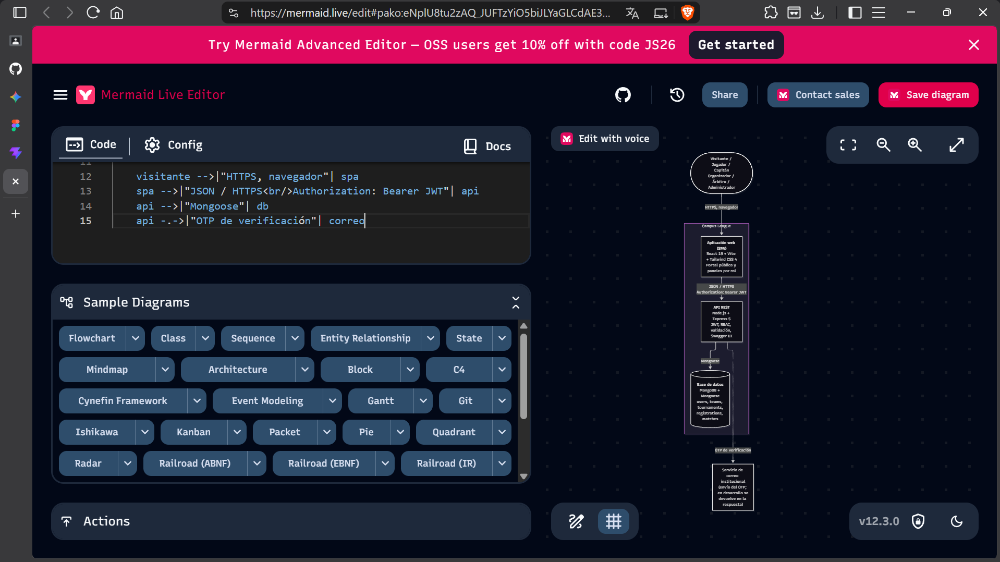
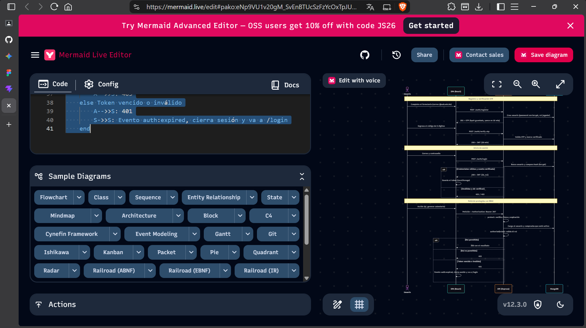

# Informe técnico: Campus League

Proyecto integrador, Tecnologías en Internet (UAB). Segunda entrega.

## 1. Resumen

Campus League es una plataforma web para gestionar torneos deportivos universitarios: inscripción de equipos, calendario, actas digitales, tabla de posiciones y estadísticas.

| Capa | Tecnología |
|---|---|
| Frontend | React 19, Vite, Tailwind CSS 4, React Router, Axios |
| Backend | Node.js, Express 5, Mongoose 9, express-validator, helmet, cors |
| Base de datos | MongoDB |
| Seguridad | JWT (30 min), bcryptjs, RBAC, OTP por correo institucional |
| Documentación | Swagger UI (OpenAPI 3.0) en `/api-docs` |

## 2. Arquitectura

Monorepo con `client/`, `server/` y `docs/`. El diagrama C4 nivel 2 está en [`diagrams/c4-nivel2-contenedores.md`](diagrams/c4-nivel2-contenedores.md) y el flujo de autenticación en [`diagrams/secuencia-jwt.md`](diagrams/secuencia-jwt.md).

Estructura del servidor: `models/` (esquemas y validadores), `controllers/` (lógica), `routes/` (rutas y validación de entrada), `middlewares/` (`protect`, `authorize`, manejo de errores), `swagger/` y `seeds/`.

## 3. Modelo de datos

| Colección | Campos principales | Índices destacados |
|---|---|---|
| `users` | nombre, correo (regex `@uab.edu.bo`), password (bcrypt, salt >= 10), rol, facultad, código estudiantil, OTP, verificado, activo | correo único, rol, facultad+rol |
| `teams` | nombre, disciplina, facultad, capitán, jugadores (usuario, camiseta, posición, activo) | nombre+disciplina único, capitán, jugadores.usuario |
| `tournaments` | nombre, disciplina, formato, fechas, cupos, reglamento, escenarios, estado, calendarioPublicado | nombre+disciplina único, disciplina+estado |
| `registrations` | torneo, equipo, inscritoPor, estado, aceptaReglamento | torneo+equipo único |
| `matches` | torneo, local, visitante, jornada, fecha, escenario, árbitro, estado, marcador, estadísticas, historial de reprogramación | torneo+fecha+escenario único, árbitro+estado |

## 4. Matriz de trazabilidad

| Requisito | Caso de uso | Endpoint(s) | Pantalla |
|---|---|---|---|
| RF-001 Registro con correo institucional y OTP | CU-01, CU-13 | `POST /auth/register`, `POST /auth/verify-otp`, `POST /auth/resend-otp` | Registro |
| RF-002 Inicio de sesión y sesión activa | CU-02 | `POST /auth/login`, `GET /auth/me` | Login, Perfil |
| RF-003 Gestión de roles | CU-12 | `PATCH /users/:id/role`, `PATCH /users/:id/status`, `GET /users` | Panel admin |
| RF-004 Crear equipo | CU-03 | `POST /teams` | Mi equipo |
| RF-005 Gestionar plantilla | CU-04 | `POST/PUT/DELETE /teams/:id/players` | Mi equipo |
| RF-006 Un equipo activo por disciplina | CU-04 | validado en `POST /teams` y `POST /teams/:id/players` | Mi equipo |
| RF-007 Crear torneo | CU-06 | `POST /tournaments`, `PUT /tournaments/:id` | Panel organizador |
| RF-008 Inscribir equipo | CU-05 | `POST /tournaments/:id/registrations` | Mi equipo |
| RF-008 Revisar inscripciones | CU-06 | `PATCH /tournaments/:id/registrations/:regId` | Panel organizador |
| RF-009 Generar y publicar calendario | CU-07 | `POST /tournaments/:id/fixture`, `POST .../fixture/publish`, `DELETE .../fixture` | Panel organizador |
| RF-010 Reprogramar y asignar árbitro | CU-08 | `PATCH /matches/:id/reschedule`, `PATCH /matches/:id/referee`, `GET /users/referees` | Panel organizador |
| RF-011 Acta digital | CU-09 | `PUT /matches/:id/result`, `GET /matches/mine` | Panel árbitro |
| RF-012 Tabla de posiciones | CU-10 | `GET /matches/standings/:torneoId` | Posiciones |
| RF-013 Goleadores y estadísticas | CU-11 | `GET /matches/scorers/:torneoId`, `GET /matches/players/:userId/stats` | Posiciones, Perfil |
| Consulta pública de torneos y calendario | CU-10 | `GET /tournaments`, `GET /matches` | Inicio, Torneos, Calendario |

La numeración de RF y CU sigue el documento de la primera entrega; ajústala si algún identificador difiere.

## 5. Matriz de endpoints por rol

Leyenda: P = público, S = cualquier sesión, J = jugador, C = capitán, O = organizador, A = árbitro, Adm = administrador.

| Módulo | Endpoint | Acceso |
|---|---|---|
| Auth | `POST /auth/register`, `verify-otp`, `resend-otp`, `login` | P |
| Auth | `GET /auth/me` | S |
| Usuarios | `GET /users`, `GET /users/:id`, `PATCH /users/:id/role`, `PATCH /users/:id/status` | Adm |
| Usuarios | `GET /users/referees` | O, Adm |
| Usuarios | `PUT /users/me` | S |
| Equipos | `GET /teams`, `GET /teams/:id` | P |
| Equipos | `GET /teams/mine` | S |
| Equipos | `POST /teams` | J, C, Adm |
| Equipos | `PUT/DELETE /teams/:id`, gestión de jugadores | Capitán del equipo, Adm |
| Torneos | `GET /tournaments`, `GET /tournaments/:id` | P |
| Torneos | `POST/PUT /tournaments`, `PATCH .../status`, calendario | O (dueño), Adm |
| Torneos | `POST .../registrations` | C, Adm |
| Torneos | `GET .../registrations` | O (todas), C (las suyas) |
| Torneos | `PATCH .../registrations/:regId` | O, Adm |
| Partidos | `GET /matches`, `GET /matches/:id`, standings, scorers, stats | P (el borrador solo lo ve el organizador) |
| Partidos | `GET /matches/mine` | A, Adm |
| Partidos | `PATCH .../referee`, `.../reschedule`, `.../reopen` | O, Adm |
| Partidos | `PUT /matches/:id/result` | A asignado, Adm |

## 6. Seguridad

- Contraseñas con bcryptjs (salt >= 10); el OTP se guarda hasheado y vence a los 10 minutos.
- JWT firmado con `JWT_SECRET`, expira a los 30 minutos. El middleware `protect` verifica firma, expiración y que la cuenta siga activa; `authorize(...roles)` aplica el RBAC.
- El rol nunca se acepta desde el cliente en el registro: toda cuenta nueva es `jugador`.
- helmet, CORS restringido a `FRONTEND_URL` y validación de entrada con express-validator en todas las rutas.
- Respuesta genérica en `resend-otp` para no revelar si un correo existe.
- Ante un 401, el cliente borra el token y redirige a `/login`.

## 7. Reglas de negocio implementadas

- Plantilla mínima y jugadores habilitados (activos, verificados y con matrícula) para inscribirse.
- Lista de espera cuando se alcanza el máximo de equipos.
- Calendario: mínimo 4 equipos aprobados, liga con algoritmo del círculo (ida y vuelta opcional) o eliminación directa, y detección de choques de escenario, equipos y árbitro con ventana de 90 minutos.
- Acta: solo el árbitro asignado; los goles individuales deben coincidir con el marcador; walkover 3-0; reapertura por el organizador dentro de 24 horas.
- Reprogramar no admite fechas pasadas y conserva el historial.
- Posiciones y goleadores se calculan en cada consulta con los partidos finalizados (3 puntos por victoria, 1 por empate).

## 8. Pruebas realizadas

Pruebas manuales sobre los datos del seed (`npm run seed`), con lint y build de producción sin errores en cada commit del cliente.

| Área | Resultado |
|---|---|
| Modelos | Validación de correo institucional, roles, fechas, duplicados y marcador negativo |
| Auth | Login rechazado sin verificar (403), verificación OTP (200), `/me` con y sin token (200 / 401) |
| Usuarios | Listado filtrado, cambio de rol, desactivación, perfil propio; no se puede cambiar el propio rol |
| Equipos | Alta con promoción a capitán, jugador duplicado (409), baja lógica, creación desde rol jugador |
| Inscripción | Equipo ya inscrito rechazado (409) |
| Calendario | Generación de 6 partidos, publicación, borrador oculto al público, conflicto de árbitro (409) |
| Reprogramación | Fecha pasada rechazada (400), choque de horario (409) |
| Acta | Descuadre de goles rechazado (400), acta cerrada (200), cerrada no editable (409), walkover 3-0 |
| Posiciones | Tabla y goleadores actualizados tras cerrar actas |
| Control de acceso | Rutas por rol en cliente (acceso restringido) y servidor (403) |

## 9. Desvíos respecto al plan

| Commit | Desvío | Motivo |
|---|---|---|
| C11 | Mensaje distinto al planeado e incluye `Team.js` y `tournamentController.js` | Corrección de un error 500 en el virtual `totalJugadoresActivos` al listar partidos |
| C17 | Tema oscuro y rutas `pages/auth/` en el mismo commit que Login y Registro | Alinear el diseño con el prototipo de Figma |
| C20 | Se añadió `ConfirmModal.jsx` y la ruta `/mi-equipo` admite el rol jugador | Reemplazar `window.confirm` y permitir crear el primer equipo |
| C21 | `Navbar.jsx` incluye avatar con enlace al perfil | Acceso al perfil |
| C22 | Incluye `GET /users/referees`, validación de fecha futura y de solapamiento de 90 min, y árbitros extra en el seed | Los organizadores no podían listar árbitros; evitar dobles asignaciones |
| C24 | Ajuste de `whitespace-nowrap` en el menú | Evitar saltos de línea con muchos enlaces |

Pendiente de documentar en Swagger: `GET /users/referees`.

## 9.1 Limitaciones conocidas

- La duración de los partidos es fija (90 minutos); una duración por disciplina requeriría un campo en el modelo de torneo.
- El OTP se muestra en la respuesta en desarrollo; en producción requiere integrar un servicio de correo.
- No existe endpoint de cambio de contraseña ni de recuperación.
- La pestaña de tarjetas del prototipo no se implementó porque no hay endpoint que las agregue por torneo.

## 10. Cómo ejecutar

Ver [README](../README.md). Resumen: `npm run install:all`, copiar los `.env.example`, `npm run seed` y `npm run dev`.

## 11. Equipo

| Integrante | Usuario | Commits |
|---|---|---|
| Samuel Eli Ramírez | deaht911 | 7 + commit inicial |
| José Alcozer | jose-1 | 7 |
| Roger Huarachi | roger69 | 7 |
| Kevin Flores | Gn_Abdias | 7 |
